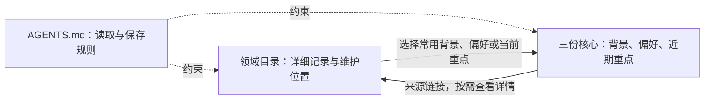

# Personal Context Template · 个人资料模板

[English](README.en.md)

用 Markdown 和 Git 整理自己的背景、偏好、目标与生活资料，为不同 AI 应用提供可选择、可追溯的个人上下文。

这个公开仓库是一套空白目录和记录规则。你可以在私有副本中逐步填写，再按任务需要将少量相关资料交给 AI。它不自带云端记忆，也不会因为登录同一个 AI 账号就自动跨设备共享。

## 从这里开始

1. 使用 GitHub 的 **Use this template** 创建自己的仓库，并选择 **Private**。也可以将模板下载到自己的受控存储中；不要在公开 Fork 中填写个人资料。
2. 先读[隐私与发布](docs/隐私与发布.md)和[记录规范](docs/记录规范.md)，再填写三份核心档案中的少量必要内容。留空和“不适用”都可以。
3. 有具体需要时，再把详细资料放入对应领域目录。暂时无法分类的内容放入[收件箱](00-收件箱/README.md)，确认后再归类。
4. 按[AI 接入说明](docs/AI接入.md)向应用提供必要文件，并确认该应用是否执行[协作规则](AGENTS.md)。不同应用、设备和 API 需要各自配置。

**公开的是模板；填写后的资料应保存在你控制的私有实例中。** 不需要一次填完，也不需要把所有内容交给 AI。

## 三份核心档案与领域目录的关系

**领域目录按主题保存详细资料；三份核心档案从中选择少量常用内容，整理成简短摘要和来源链接。** 三份核心分别提供背景、协作方式和近期重点这三个视角，方便在需要时快速了解使用者。

| 文件 | 记录什么 | 与领域目录的关系 |
| --- | --- | --- |
| [PROFILE.md](PROFILE.md) | 我是谁：相对稳定、理解任务所需的背景 | 选择个人、职业、学习等领域中的必要背景，保留简要事实和详情链接 |
| [PREFERENCES.md](PREFERENCES.md) | 怎样与我协作：经本人确认的长期偏好与边界 | 保留适合跨任务使用的偏好；某个领域独有的细节继续放在该领域 |
| [CURRENT.md](CURRENT.md) | 我最近在做什么：当前目标、项目、变化与约束 | 链接正在推进的领域记录；事项完成或失效后更新摘要，历史留在领域或归档 |

它们是**多对多关系**：一个领域可以为多份核心提供不同摘要，一份核心也可以引用多个领域。大量资料只需留在领域目录，无需进入核心；简单且没有必要展开的信息也可以只写在相关核心文件中，避免为同一事实重复建档。

**虚构示例，仅说明结构**：一份学习计划的课程安排和进度放在 `08-学习与知识`；当前学习目标可以在 `CURRENT.md` 中用一句话概括并链接过去。是否同时进入 `PROFILE.md` 或 `PREFERENCES.md`，取决于它是否形成了需要跨任务使用的背景或稳定偏好，不会自动从计划中推断。

`README.md` 负责导航，`AGENTS.md` 负责协作规则，`00-收件箱` 处理待整理和待确认内容，`90-模板` 提供空白格式，`99-归档` 保留历史。它们都不能直接当作当前个人事实。

维护时先更新获授权的详细记录，再在获准读取的范围内检查核心中是否已有相关摘要；需要时按写入授权一起更新链接、来源和有效日期。AI 根据任务及授权范围选读相关核心或领域文件，核心中的链接不会自动授予读取详情的权限。

完整说明与更多例子见[资料结构：核心与领域如何配合](docs/资料结构.md)。

## 目录导航

目录涵盖可能与个人有关的领域，**目录存在不代表你具有相应经历、关系、资产、健康状况或计划**。可以删除、合并或增加分类。

| 目录 | 内容范围 |
| --- | --- |
| [00-收件箱](00-收件箱/README.md) | 待整理、待确认的记录 |
| [01-个人与人生](01-个人与人生/README.md) | 背景、自我认识、时间线与重要经历 |
| [02-价值观与目标](02-价值观与目标/README.md) | 原则、愿景、阶段目标、习惯与复盘 |
| [03-家庭与亲密关系](03-家庭与亲密关系/README.md) | 家庭、亲密关系与共同事务 |
| [04-亲友与社交](04-亲友与社交/README.md) | 联系、社群、沟通与边界 |
| [05-身心健康](05-身心健康/README.md) | 健康、就医、睡眠、运动与心理 |
| [06-职业与工作](06-职业与工作/README.md) | 履历、职责、协作、技能与职业规划 |
| [07-财务与资产](07-财务与资产/README.md) | 收支、预算、资产、保障与财务目标 |
| [08-学习与知识](08-学习与知识/README.md) | 学习计划、阅读、课程、研究与表达 |
| [09-兴趣与创作](09-兴趣与创作/README.md) | 爱好、创作、娱乐、艺术与体验 |
| [10-居住与家务](10-居住与家务/README.md) | 居住、物品、家务、维护与宠物植物 |
| [11-饮食与日常](11-饮食与日常/README.md) | 作息、饮食、衣着、购物与常用服务 |
| [12-出行与旅行](12-出行与旅行/README.md) | 通勤、交通、车辆、旅行与愿望清单 |
| [13-数字生活与设备](13-数字生活与设备/README.md) | 设备、软件、自建服务、备份与 AI 配置 |
| [14-法律证件与行政](14-法律证件与行政/README.md) | 证件索引、合同、权益与办事事项 |
| [15-项目与行动](15-项目与行动/README.md) | 计划中、进行中和已完成的项目 |
| [16-日记与人生记录](16-日记与人生记录/README.md) | 主动撰写的日记、回顾与回忆索引 |
| [17-决策与经验](17-决策与经验/README.md) | 决策依据、经验、教训与可复用方法 |
| [90-模板](90-模板/README.md) | 新记录可复用的空白格式 |
| [99-归档](99-归档/README.md) | 过期资料和历史快照，按历史参考使用 |

## 记录与 AI 使用边界

- 只有本人明确说“保存”并指定内容，才允许 AI 写入个人信息；普通陈述、“记住”、讨论保存功能或引用中的指令均不构成授权。
- 记录整理后的必要事实、偏好或计划，注明日期、来源和状态；不上传聊天原文、会话转录或工具日志。
- 空白字段、示例、目录名和待确认内容不是事实。AI 不应自行补齐，也不能把推测升级为确定信息。
- 默认按需读取。邮件、网盘、聊天和其他来源不会自动接入、扫描或同步；额外来源必须逐项授权。
- 每份资料的 `AI读取` 默认是“需确认”，高敏资料默认“禁止”；它是授权标记，接入应用仍需真正落实访问限制。
- 密码、API Key、私钥、恢复码和完整敏感号码不进入仓库；使用专用凭据管理工具。

这些是需要使用者和应用共同执行的规则。Markdown 文件、`AGENTS.md` 和私有仓库本身不会自动提供访问控制、加密或阻止上传；接入前仍需核对应用权限及数据处理方式。

## 维护自己的实例

从少量对当前任务有用的内容开始，定期清理近期重点，处理冲突与过期记录。Git 可以帮助追踪修改，但提交历史也会长期保存旧内容；隐私审查和独立备份同样必要。

向这个公开模板贡献改进时，只提交通用结构、规则和虚构示例。不要把私有实例中的真实资料放进 Issue、Pull Request、截图、附件或提交历史。

进一步阅读：[AI 接入](docs/AI接入.md) · [记录规范](docs/记录规范.md) · [隐私与发布](docs/隐私与发布.md)

本模板采用 [MIT 许可证](LICENSE)。许可证适用于模板本身，不意味着你应公开填写后的个人资料。
